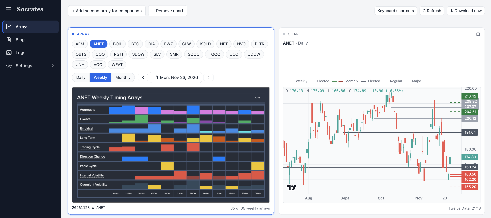
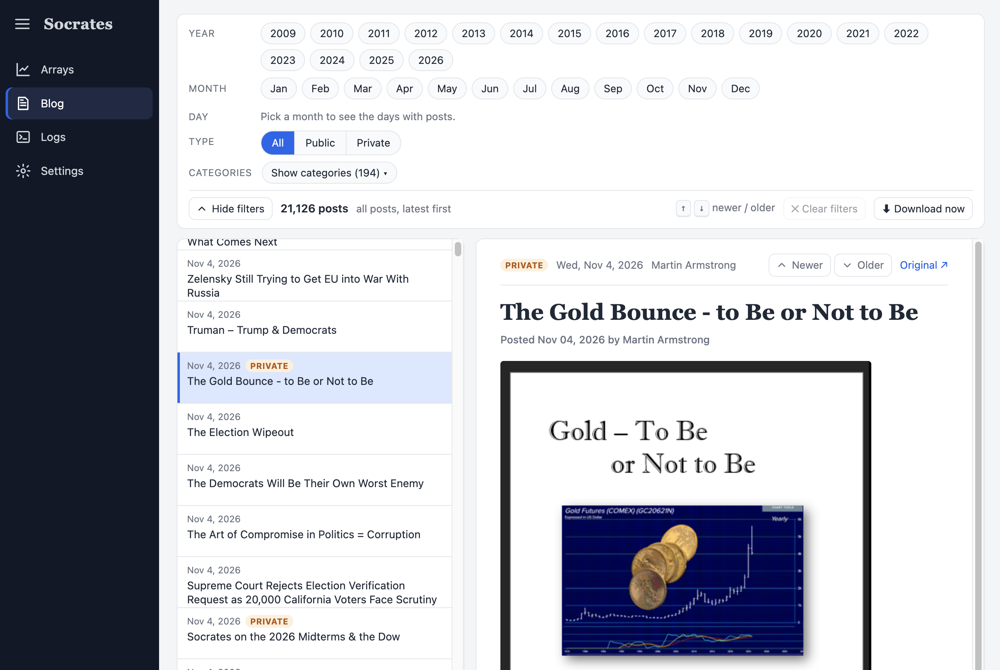

# Socrates

[](LICENSE)
[](https://github.com/FatoYo/socrates/pkgs/container/socrates)

A self-hosted web app for your Socrates subscription. It keeps a local archive of the timing arrays, the reversals and the Armstrong Economics blog up to date with scheduled downloads, and lets you browse, compare and chart them in the browser.

> **Note**
> Socrates is an independent project and is not affiliated with Armstrong Economics or the Socrates Platform. It only downloads what your own subscription gives you access to: the timing arrays and reversals from the [Socrates Platform](https://standard.socratesplatform.com/) and the posts of the [Armstrong Economics blog](https://www.armstrongeconomics.com/blog/). You are responsible for following those sites' terms of use.

## Features

### Timing arrays


- Daily, Weekly and Monthly arrays of every market you subscribe to.
- A calendar that only offers dates with an array.
- Two arrays side by side, the second following the first one's date.
- Keyboard navigation: arrows for dates and tickers, `D` / `W` / `M` for the time frame, `Option` + `S` to find a ticker.

### Reversals and price chart



- Daily candles of the array's ticker next to it, from [Twelve Data](https://twelvedata.com/) (a free API key is enough).
- The weekly and monthly reversals drawn as horizontal rays, major ones prioritized.
- `H` marks the array's date on the chart, `R` shows or hides the reversals, and the chart can be maximized.

### Blog archive



- Every public and private post saved as markdown in your own folder, so you keep it if it changes on the site.
- Read and filter the archive by date, public or private, and category.

### Automatic downloads

- Arrays and reversals every morning: daily Tuesday to Saturday, weekly on Saturday, monthly on the 1st. Failed ones are retried.
- New blog posts every 12 hours.
- **Download now** on the Arrays and Blog pages, and a Logs page with the output of every run.

## How it works

The web app runs two downloaders on its schedule. Both also work on their own from the command line.

| Folder | What it does |
|--------|--------------|
| [`socrates-app/`](socrates-app/README.md) | The web app: browsing, chart, settings, schedule and logs |
| [`socrates-arrays-extractor/`](socrates-arrays-extractor/README.md) | Saves the timing arrays as images, one folder per ticker, and the reversals in a SQLite database |
| [`ae-blog/`](ae-blog/README.md) | Saves the blog posts as markdown files with Obsidian-compatible front matter, one folder per year |

Arrays and posts are plain files in folders you choose, so you can use them outside the app too.

## Installation

### Docker (recommended for a server)

The image `ghcr.io/fatoyo/socrates` contains the app, both downloaders and Chromium, for `linux/amd64` and `linux/arm64`. There are two compose files: `compose-basic.yaml` for a quick start, and `compose.yaml`, a more hardened setup for a server.

#### Quick start

```bash
mkdir socrates && cd socrates
curl -o compose.yaml https://raw.githubusercontent.com/FatoYo/socrates/main/compose-basic.yaml
mkdir -p data arrays blog
docker compose up -d
```

Open `http://<server>:3141`. Under **Settings › Archive**, enter your Socrates login and set the folders to `/archive/arrays` and `/archive/blog`, then add your markets under **Settings › Markets**. Data, arrays and posts go to the `data`, `arrays` and `blog` folders; the comments in the file explain how to change them.

#### Server setup

1. Create a folder on the server and download the compose file and the settings template:
   ```bash
   mkdir socrates && cd socrates
   curl -O https://raw.githubusercontent.com/FatoYo/socrates/main/compose.yaml
   curl -o .env https://raw.githubusercontent.com/FatoYo/socrates/main/.env.example
   ```
2. Edit `.env`. Each setting is explained in the file. The main ones:
   - `HOST_IP` and `TS_IP`: the server's own LAN and Tailscale addresses, the only addresses the app is published on. Remove the Tailscale port line from `compose.yaml` if you don't use Tailscale.
   - `DATA_LOCATION`: the folder on the server for the app's settings, logs and schedule.
   - `ARRAYS_LOCATION` and `BLOG_LOCATION`: the folders on the server for the arrays and the blog posts, for example on an NFS share.
   - `PUID` and `PGID`: the user the container runs as, which must be able to write to those three folders.
   - `TZ`: your time zone, used for the download schedule.
3. Start it:
   ```bash
   docker compose up -d
   ```
4. Open `http://<HOST_IP>:3141`, then set up **Settings › Archive** and **Settings › Markets** as in the quick start.

To update, run `docker compose pull && docker compose up -d`. To stay on a version, set `SOCRATES_VERSION` in `.env`, for example `1.2`.

**Verifying the image.** Every release image is built by this repository's GitHub workflow and signed, so you can check where it came from:
```bash
gh attestation verify oci://ghcr.io/fatoyo/socrates:1.2 --owner FatoYo
```
Each version is also listed under [Releases](https://github.com/FatoYo/socrates/releases).

**Data and security.** Settings, logins, reversals, logs and the schedule are kept in the data folder (`DATA_LOCATION`, `./data` in the quick start). Back it up and keep it private: it holds your Socrates password and Twelve Data key. The container runs as a regular user without extra privileges, on a read-only filesystem, and only sees its data folder and the two archive folders. The app has no login of its own, so publish it only on your home network or a VPN such as Tailscale. To reach it from the internet, put it behind a service that adds a login, for example a [Cloudflare Tunnel](https://developers.cloudflare.com/cloudflare-one/connections/connect-networks/) with Cloudflare Access, [Pangolin](https://github.com/fosrl/pangolin), or a reverse proxy with an identity provider such as [Pocket ID](https://github.com/pocket-id/pocket-id) or [Authelia](https://www.authelia.com/). Never publish it on the internet without one.

### Locally on a Mac or Windows PC

On your own computer the app runs best directly with its shell script, without Docker.

Requirements:
- Python 3.11 or higher
- Google Chrome or Chromium, for the downloads (browsing works without it)
- On Windows: [WSL](https://learn.microsoft.com/windows/wsl/install) with a Linux distribution such as Ubuntu, because the scripts are bash scripts. Install Python and Chrome inside WSL.

Start it:
```bash
git clone https://github.com/FatoYo/socrates.git
cd socrates/socrates-app
./socrates.sh
```

Open <http://localhost:8050>. The first start installs the dependencies. Set up **Settings › Archive** and **Settings › Markets**; downloads run while the app is running.

The [app's README](socrates-app/README.md) lists all options, pages and keyboard shortcuts.

## License

Copyright (C) 2025-2026 FatoYo

Licensed under the GNU Affero General Public License v3.0 (AGPL-3.0), see [LICENSE](LICENSE). This project is not affiliated with Armstrong Economics or the Socrates Platform. It needs your own subscription, and you are responsible for following those sites' terms of use.
