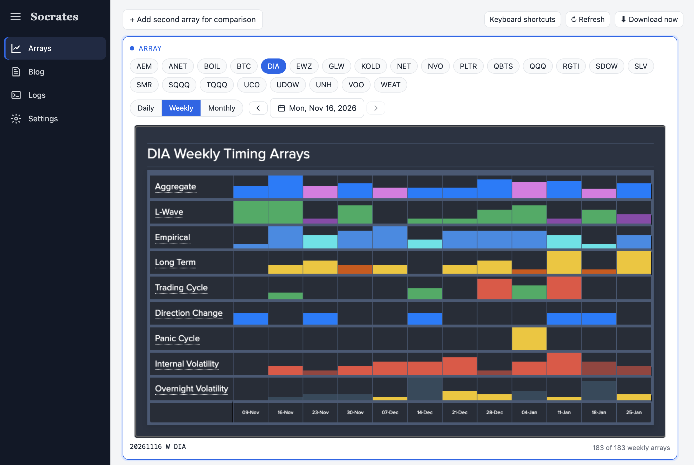

# Socrates

[](LICENSE)
[](https://github.com/FatoYo/socrates/pkgs/container/socrates)

A self-hosted web app for browsing Socrates timing arrays and the Armstrong Economics blog. It keeps your own archive up to date with scheduled downloads and lets you search, filter and compare it in the browser.

> **Note**
> Socrates is an independent project and is not affiliated with Armstrong Economics or the Socrates Platform. It only downloads and displays content that your own subscription gives you access to: the timing arrays from the [Socrates Platform](https://standard.socratesplatform.com/) and the public and private posts of the [Armstrong Economics blog](https://www.armstrongeconomics.com/blog/). You need a Socrates Platform subscription, and you are responsible for following those sites' terms of use.

## Features

### Timing arrays



- Browse the Daily, Weekly and Monthly arrays of every ticker you follow.
- Jump to any date with a calendar that only offers dates with an array.
- Compare two arrays side by side. The second column follows the first one's date.
- Navigate with the keyboard: arrows for dates and tickers, `D` / `W` / `M` for the time frame, `Option` + `S` to find a ticker.

### Blog archive


- Keep a local backup of the blog: every public and private post is saved as a markdown file in your own folder, so you still have it if a post changes or disappears from the site.
- Read the whole archive, public and private posts, rendered from markdown.
- Filter by year, month, day, public or private, and category.
- Move to the newer or older post with the arrow keys. The filter header folds away for reading.

### Automatic downloads

- Downloads new arrays every morning: daily arrays Tuesday to Saturday, weekly arrays on Saturday and monthly arrays on the 1st. Failed arrays are retried.
- Checks the public and private blog for new posts every 12 hours.
- Settings page for the Socrates login, the list of tickers and the schedule. Newly added tickers get their daily, weekly and monthly arrays straight away.
- **Download now** buttons on the Arrays and Blog pages, and a Logs page with the output of every run, filtered by level, job and date.

## How it works

The repository holds three parts. The web app runs the two downloaders on its schedule; both can also be used on their own from the command line.

| Folder | What it does |
|--------|--------------|
| [`socrates-app/`](socrates-app/README.md) | The web app: browsing, settings, schedule and logs |
| [`socrates-arrays-extractor/`](socrates-arrays-extractor/README.md) | Logs in to the Socrates Platform and saves the timing arrays as images, one folder per ticker |
| [`ae-blog/`](ae-blog/README.md) | Saves the public and private blog posts as markdown files with Obsidian-compatible front matter, one folder per year |

The arrays and posts are plain files in two folders you choose, so you can also use them outside the app.

## Installation

### Docker (recommended for a server)

The image `ghcr.io/fatoyo/socrates` contains the app, both downloaders and Chromium, for `linux/amd64` and `linux/arm64`.

1. Create a folder on the server and download the compose file and the settings template:
   ```bash
   mkdir socrates && cd socrates
   curl -O https://raw.githubusercontent.com/FatoYo/socrates/main/compose.yaml
   curl -o .env https://raw.githubusercontent.com/FatoYo/socrates/main/.env.example
   ```
2. Edit `.env`. Each setting is explained in the file. The main ones:
   - `HOST_IP` and `TS_IP`: the server's own LAN and Tailscale addresses, the only addresses the app is published on. Remove the Tailscale port line from `compose.yaml` if you don't use Tailscale.
   - `ARRAYS_LOCATION` and `BLOG_LOCATION`: the folders on the server for the arrays and the blog posts, for example on an NFS share.
   - `PUID` and `PGID`: the user the container runs as, which must be able to write to those two folders.
   - `TZ`: your time zone, used for the download schedule.
3. Start it:
   ```bash
   docker compose up -d
   ```
4. Open `http://<HOST_IP>:3141`. On the Settings page, set the folders to `/archive/arrays` and `/archive/blog`, enter your Socrates login and add your tickers.

To update, run `docker compose pull && docker compose up -d`. To stay on a version, set `SOCRATES_VERSION` in `.env`, for example `1.0`.

**Verifying the image.** Every release image is built by this repository's GitHub workflow and signed with a build attestation, so you can check that it really came from here before you run it:
```bash
gh attestation verify oci://ghcr.io/fatoyo/socrates:1.0 --owner FatoYo
```
Each version is also listed under [Releases](https://github.com/FatoYo/socrates/releases).

**Data and security.** Settings, the Socrates login, logs and the schedule are kept in the Docker volume `socrates-data`, which survives updates. `docker compose down -v` deletes it, so back it up and avoid that command. The container runs as a regular user with all extra privileges removed, a read-only filesystem and its own network, and it only sees the two archive folders. The app has no login of its own, so publish it only on your home network or a VPN such as Tailscale. To reach it from the internet, put it behind a service that adds a login, for example a [Cloudflare Tunnel](https://developers.cloudflare.com/cloudflare-one/connections/connect-networks/) with Cloudflare Access, [Pangolin](https://github.com/fosrl/pangolin), or a reverse proxy with an identity provider such as [Pocket ID](https://github.com/pocket-id/pocket-id) or [Authelia](https://www.authelia.com/). Never publish it on the internet without one.

### Locally on a Mac or Windows PC

On your own computer the app runs best directly with its shell script, without Docker.

Requirements:
- Python 3.11 or higher
- Google Chrome or Chromium, for the downloads (browsing works without it)
- On Windows: [WSL](https://learn.microsoft.com/windows/wsl/install) with a Linux distribution such as Ubuntu, because the scripts are bash scripts. Install Python and Chrome inside WSL.

Start it:
```bash
git clone https://github.com/FatoYo/socrates.git
cd socrates/socrates-app
./socrates.sh
```

Open <http://localhost:8050>. The first start creates a Python environment and installs the dependencies. On the Settings page, enter the folders for your arrays and blog posts, your Socrates login and your tickers. Automatic downloads run while the app is running.

The [app's README](socrates-app/README.md) lists all options, pages and keyboard shortcuts. To use the downloaders on their own, see [socrates-arrays-extractor](socrates-arrays-extractor/README.md) and [ae-blog](ae-blog/README.md).

## License

Copyright (C) 2025-2026 FatoYo

Licensed under the GNU Affero General Public License v3.0 (AGPL-3.0), see [LICENSE](LICENSE). This project is not affiliated with Armstrong Economics or the Socrates Platform. It needs your own subscription, and you are responsible for following those sites' terms of use.
